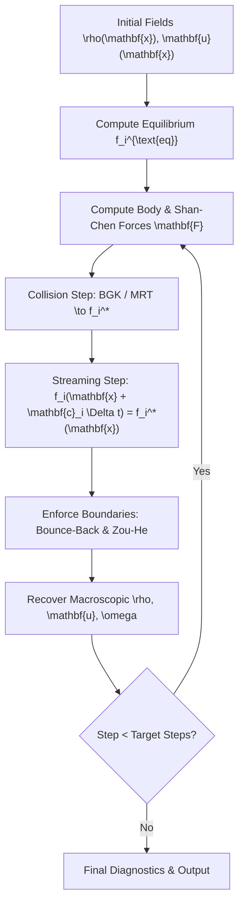

# ChronoLattice

[](https://github.com/ZengLLQ/chrono-lattice/actions)
[](https://www.python.org/downloads/)
[](https://opensource.org/licenses/MIT)

**ChronoLattice** is a high-performance Lattice Boltzmann Method (LBM) fluid dynamics and multiphase flow simulator written in pure Python. It implements 2D 9-velocity (D2Q9) mesoscopic kinetic dynamics, featuring Bhatnagar-Gross-Krook (BGK) and Multiple Relaxation Time (MRT) collision operators, Shan-Chen diffuse-interface pseudopotentials, no-slip half-way bounce-back obstacles, and Zou-He velocity/pressure boundaries.

---

## Theoretical Foundations

### 1. Discrete Boltzmann Equation & D2Q9 Lattice
The continuum Boltzmann transport equation is discretized onto a spatial grid with 9 discrete microscopic velocities $\mathbf{c}_i$ ($i = 0, \dots, 8$):

$$
\mathbf{c}_0 = (0, 0)
$$
$$
\mathbf{c}_{1..4} = (\pm 1, 0), (0, \pm 1), \quad w_{1..4} = \frac{1}{9}
$$
$$
\mathbf{c}_{5..8} = (\pm 1, \pm 1), \quad w_{5..8} = \frac{1}{36}, \quad w_0 = \frac{4}{9}
$$

The lattice speed of sound is $c_s = 1/\sqrt{3}$ in lattice units ($\Delta x = \Delta t = 1$), yielding $c_s^2 = 1/3$.

The discrete Maxwellian equilibrium distribution $f_i^{\text{eq}}(\rho, \mathbf{u})$ truncated to second order in Mach number is:

$$
f_i^{\text{eq}}(\rho, \mathbf{u}) = w_i \rho \left(1 + \frac{\mathbf{c}_i \cdot \mathbf{u}}{c_s^2} + \frac{(\mathbf{c}_i \cdot \mathbf{u})^2}{2 c_s^4} - \frac{\mathbf{u} \cdot \mathbf{u}}{2 c_s^2}\right)
$$

Macroscopic density $\rho$ and momentum $\rho \mathbf{u}$ are recovered via velocity moments:

$$
\rho(\mathbf{x}, t) = \sum_{i=0}^8 f_i(\mathbf{x}, t)
$$

$$
\rho(\mathbf{x}, t) \mathbf{u}(\mathbf{x}, t) = \sum_{i=0}^8 f_i(\mathbf{x}, t) \mathbf{c}_i + \frac{1}{2} \mathbf{F}(\mathbf{x}, t) \Delta t
$$

---

### 2. Collision Dynamics: BGK & MRT

#### Single Relaxation Time (BGK)
Under the BGK approximation with Guo external force coupling:

$$
f_i^*(\mathbf{x}, t) = f_i(\mathbf{x}, t) - \frac{1}{\tau} \left[f_i(\mathbf{x}, t) - f_i^{\text{eq}}(\rho, \mathbf{u})\right] + F_i \Delta t
$$

The kinematic shear viscosity $\nu$ matches the macroscopic Navier-Stokes equations:

$$
\nu = c_s^2 \left(\tau - \frac{1}{2}\right) \Delta t = \frac{2\tau - 1}{6}
$$

#### Multiple Relaxation Time (MRT)
To maximize numerical stability at high Reynolds numbers, distribution functions are projected onto orthogonal moment space via matrix $\mathbf{M}$:

$$
\mathbf{m} = \mathbf{M} \mathbf{f}, \quad \mathbf{m}^* = \mathbf{m} - \mathbf{S} (\mathbf{m} - \mathbf{m}^{\text{eq}}), \quad \mathbf{f}^* = \mathbf{M}^{-1} \mathbf{m}^*
$$

Where $\mathbf{S} = \text{diag}(0, s_e, s_\epsilon, 0, s_q, 0, s_q, s_\nu, s_\nu)$ allows independent relaxation of acoustic, thermal, and shear stress modes.

---

### 3. Shan-Chen Multiphase Pseudopotential
Non-ideal multi-phase fluid separation is driven by a non-local interparticle potential $\psi(\rho) = \rho_0 (1 - e^{-\rho/\rho_0})$:

$$
\mathbf{F}_{\text{SC}}(\mathbf{x}) = -G \psi(\mathbf{x}) \sum_{i=1}^8 w_i \psi(\mathbf{x} + \mathbf{c}_i) \mathbf{c}_i
$$

Where interaction parameter $G < 0$ governs molecular cohesion. When $|G| > G_{\text{crit}}$, spontaneous spinodal decomposition separates the fluid into coexisting liquid and vapor phases obeying the Young-Laplace equation across droplet interfaces:

$$
\Delta P = \frac{\sigma}{R}
$$

---

## Simulation Workflow



---

## Installation

```bash
# Clone repository
git clone https://github.com/ZengLLQ/chrono-lattice.git
cd chrono-lattice

# Install package in editable mode
pip install -e .
```

---

## CLI Simulation Commands

### 1. Poiseuille Channel Flow
```bash
chronolattice poiseuille --nx 100 --ny 40 --tau 0.8 --body-force 0.0001 --steps 500
```

### 2. Karman Vortex Street Shedding
```bash
chronolattice karman --nx 160 --ny 50 --u-in 0.08 --steps 400
```

### 3. Multiphase Phase Separation
```bash
chronolattice multiphase --nx 64 --ny 64 --g-interaction -5.5 --steps 200
```

---

## Python API Usage

```python
import numpy as np
from chronolattice import LBMSolver, MRTCollision, create_channel_walls, BounceBackBoundary

# 1. Setup channel domain
nx, ny = 120, 40
walls = create_channel_walls(nx, ny)
bcs = [BounceBackBoundary(walls)]

# 2. Instantiate solver with MRT collision operator
solver = LBMSolver(
    nx=nx,
    ny=ny,
    collision_op=MRTCollision(tau=0.6),
    boundaries=bcs,
    body_force_x=1e-4,
)

# 3. Advance simulation
solver.run(steps=300)

# 4. Extract diagnostics
print(f"Max Velocity: {np.max(solver.u):.5f}")
print(f"Kinetic Energy: {solver.total_kinetic_energy:.5e}")
```

---

## Testing

Run the full automated test suite:

```bash
pytest -v
```

---

## License

This software is released under the [MIT License](LICENSE).
